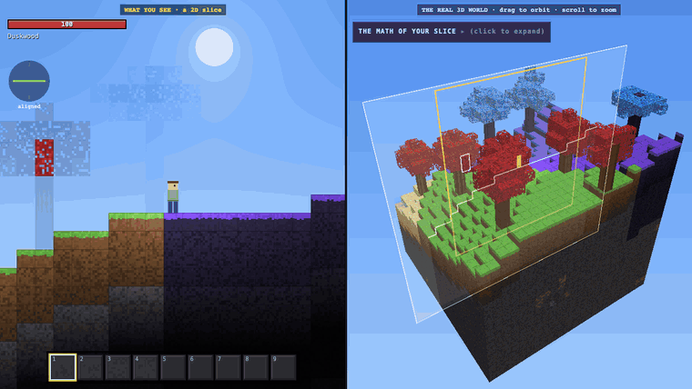
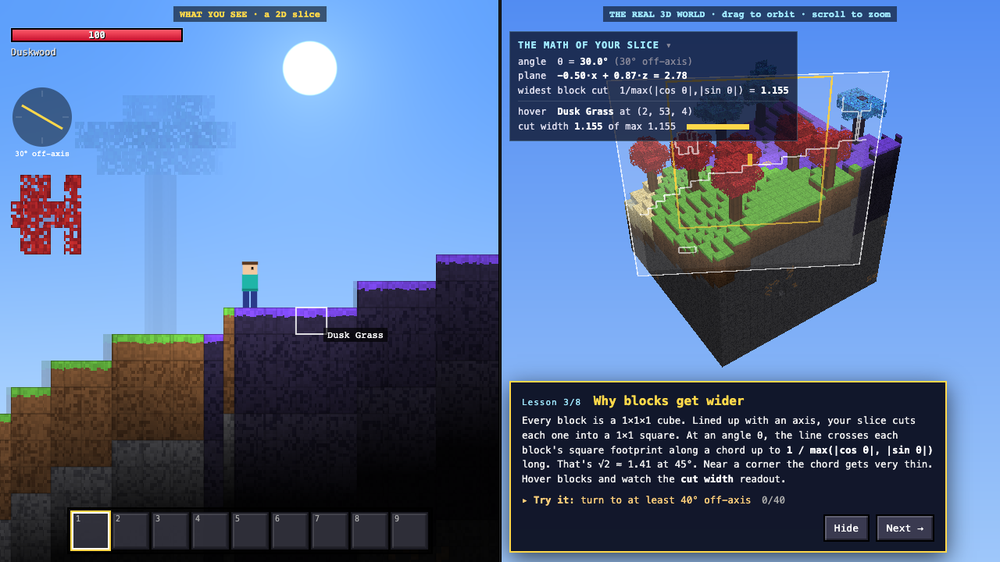
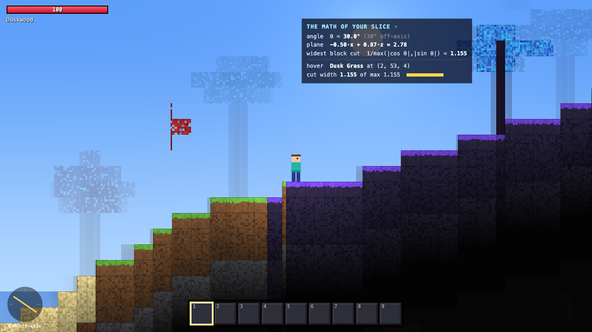
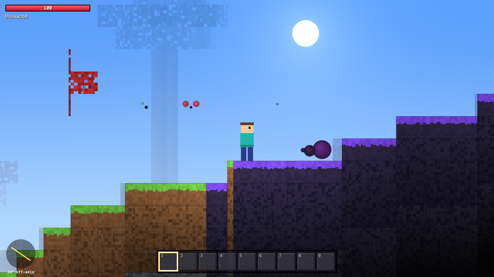
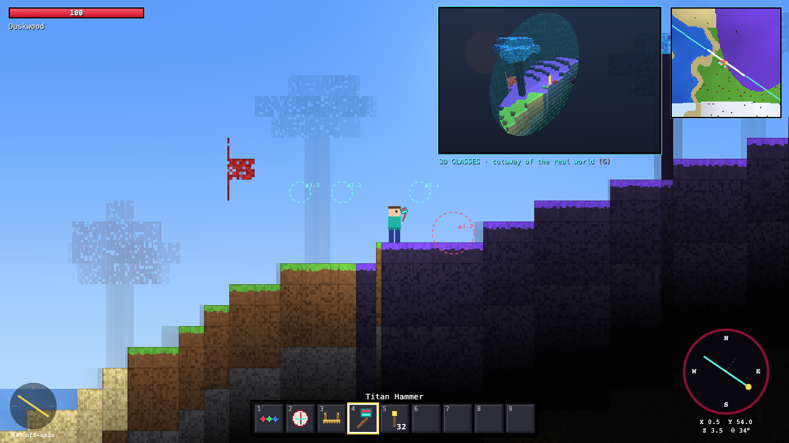
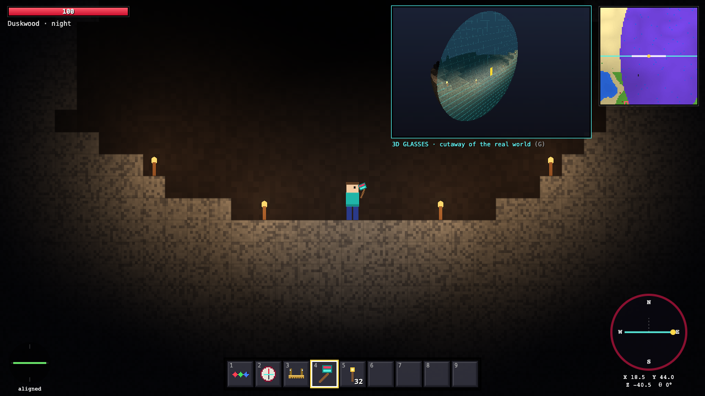
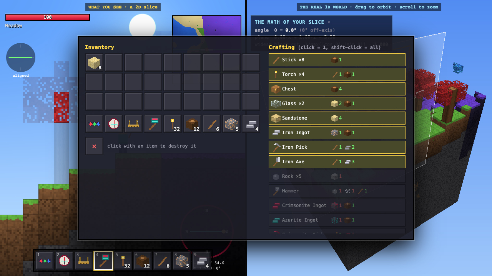

<div align="center">

# FLATLANDER

### You are flat. The world is not.

**A 3D voxel world you can only see one 2D slice of.**
Turn your slice through the third dimension to explore, mine, craft and survive.

[**▶ Play in your browser**](https://nickitakhy.me/flatlander/) · [How it works](#how-it-works) · [Run locally](#run-locally)

[](https://github.com/nickita-khylkouski/flatlander/actions/workflows/ci.yml)




<sub>Left: everything the player can see. Right: the real 3D world, with the player's slice drawn as a white sheet.</sub>

</div>

---

## The idea

You are a **two-dimensional being** living in a **three-dimensional block world**. All you can see is one
vertical slice of it, like a side-scroller. The rest of the world is still there, just in a direction
you can't look.

**Scroll the mouse wheel to rotate your slice** around the vertical line through your body, and the world
reshapes in front of you:

- Blocks get **wider and narrower** because the plane cuts each cube at a new angle.
- Tree trunks show **growth rings** as stripes whose spacing shifts as you turn.
- **Caves and ore appear out of nowhere**, because they were half a block beside you the whole time.
- **Creatures fade in from nothing**. Their 3D bodies cross your plane as circles that grow, peak and shrink away.

Nothing in the world moves when you rotate. You're only cutting it differently.

<p align="center"></p>

## Features

| | |
|---|---|
| 🌍 **Infinite 3D world** | Chunked voxel terrain with 4 biomes (Meadow, Desert, Tundra, Duskwood), winding and cavernous caves, lava, lakes, three ore tiers and several tree types. |
| 🔪 **True cross-section rendering** | A fragment shader slices a 3D texture of the world for every pixel, so cubes, logs, torches and ores are cut exactly at your angle. |
| 🧠 **Educational mode** | Split screen showing the real 3D world, your slice as a translucent sheet and the cut outlined. Includes live math and 8 short interactive lessons. |
| ⛏️ **Survival + crafting** | Mining with tool tiers, 20 recipes, chests, torches, health, fall damage, potions, and a day/night cycle. |
| 🕷️ **3D creatures** | Phase spiders, butterflies and jellyfish move in full 3D. You only see (and can only hit) the parts crossing your plane. |
| 🧭 **Navigation gadgets** | A **Compass** shows your position and heading, a **Cartograph** shows a top-down map, and **3D Glasses** show outlines of things outside your slice plus a ray-marched cutaway. |
| 💾 **Saves** | Autosave to `localStorage`, storing only your edits, so saves stay small. |
| ⚡ **Fast** | 200+ fps at Retina resolution on an M-series Mac. Automatically lowers resolution on slower GPUs. |

<table>
<tr>
<td width="50%"><br><sub><b>The slice view.</b> The cut is 34° off-axis, so every block shows up slightly wider than a square.</sub></td>
<td width="50%"><br><sub><b>Creatures as cross-sections.</b> A spider's body, head and legs are spheres that show up as circles.</sub></td>
</tr>
<tr>
<td width="50%"><br><sub><b>3D Glasses, Compass and Cartograph.</b> Dashed rings mark creatures outside your slice, with their distance.</sub></td>
<td width="50%"><br><sub><b>Underground.</b> Torches light the area around them in 3D, so a torch just off your slice can still light it.</sub></td>
</tr>
</table>

## How it works

### The slice
Your slice is the vertical plane through your position `p` with horizontal direction `f = (cos θ, 0, sin θ)`.
A point on screen at horizontal offset `u` and height `v` is the world point

```
world(u, v) = (p.x + u·cos θ,  v,  p.z + u·sin θ)
```

The renderer evaluates this **per pixel** in a fragment shader and looks up which block contains that
point. That's why blocks show their true cross-sections at any angle, not pre-drawn sprites.

### Why blocks change width
A unit cube's footprint is a unit square. Your slice crosses that square along a straight chord, and the
longest chord at angle θ is

```
w_max(θ) = 1 / max(|cos θ|, |sin θ|)        →  1 at 0°,  √2 ≈ 1.414 at 45°
```

Chords that pass near a corner are thinner, so at an angle you see a mix of wide and sliver-thin blocks.

### Why creatures are circles
Creatures are built from spheres. A sphere of radius `r` whose center is a distance `d` from your plane
shows up as a circle of radius

```
ρ = √(r² − d²)      (nothing at all when d ≥ r)
```

So a creature walking toward your plane starts as a dot, grows to full size and shrinks away as it
passes through. This is the same thing that happens to the Square in Edwin Abbott's *Flatland* (1884)
when a Sphere visits.

### Moving in a world you can't see
You can only walk along your slice. To go somewhere else, you **turn** (rotate the slice) and then walk.
Collision uses a grid traversal (Amanatides–Woo) along your 0.6-block-wide footprint on the slice line.
If a turn would cut a block through your body, it's refused. In tight tunnels the game first slides you
up to half a block sideways to make room.

## Educational mode

Turn it on when you create a world (it's on by default). The screen splits:

- **Left:** what you see, a 2D slice.
- **Right:** the real 3D chunk around you. Your slice is a translucent sheet, the cut through the terrain
  is outlined in white, and the **yellow rectangle** is exactly the part of the slice on your screen.
  Drag to orbit and scroll to zoom. The block under your cursor lights up in 3D.
- **Live math:** your angle, the plane equation, `w_max(θ)`, the exact cut width of the hovered block, and
  `√(r² − d²)` for the nearest creature crossing your slice.
- **8 lessons**, each with a small task: *You are flat, Turning through the 3rd dimension, Why blocks
  get wider, Right next to you and invisible, You removed a whole cube, Circles from spheres,
  Reading 3D from 2D cuts,* and *Flatland*.

`V` toggles the split view, `L` toggles lessons.

## Controls

| Key | Action |
|---|---|
| `A` / `D` | Walk along your slice (`Shift` = run) |
| `Space` / `W` | Jump · swim up (`S` = swim down) |
| **Scroll** · `Z` / `X` | **Rotate your slice through the 3rd dimension** |
| `R` | Snap to the nearest axis |
| Left mouse | Mine · attack |
| Right mouse | Place block · use item · open chest |
| `1`–`9` · `Shift`+Scroll | Choose a hotbar slot (or click it) |
| `E` / `Tab` | Inventory + crafting |
| `+` / `−` · pinch | Zoom |
| `G` · `M` · `F` | 3D Glasses view · map · depth haze |
| `V` · `L` | Educational split view · lessons |
| `H` | Controls card |
| `Esc` | Pause (settings, quality, save) |

## Progression

<p align="center"></p>

1. **Punch Emberleaf leaves** for sticks. Punch logs for wood.
2. **Dig dirt while holding a stick.** Half the time you'll find a rock.
3. Survive the night. **Phase spiders** drop **phase silk**.
4. Rock + phase silk + stick = **Hammer**, which can mine stone and iron.
5. Ore + wood = ingots: **Iron** → Iron Pick → **Crimsonite** (y ≤ 20) → Crimsonite Pick → **Azurite** (y ≤ 12).
6. Build your navigation kit:
   - **Compass:** 3 iron + 1 crimsonite.
   - **Cartograph:** 2 iron + glass + stick.
   - **3D Glasses:** red + green + blue lenses (from butterflies) + 2 Dusk Wood.
7. Endgame: the **Titan Hammer**.

Difficulty is chosen per world. On **Peaceful**, spiders still spawn (you need their silk) but never attack.

## Run locally

No build step and no dependencies. ES modules just need to be served over HTTP:

```bash
git clone https://github.com/nickita-khylkouski/flatlander.git
cd flatlander
npm start            # zero-dependency Node server → http://localhost:8374
# or: python3 -m http.server 8374
```

Requires a browser with **WebGL2** (any recent Chrome, Edge, Firefox or Safari).

```bash
npm test             # unit tests for world gen, collision, crafting, saves (node:test, no deps)
npm run lint         # eslint
```

## Project structure

```
flatlander/
├── index.html               # page shell: canvases, HUD, menus
├── src/
│   ├── main.js              # game loop, input, interaction, mobs, overlay, split view
│   ├── style.css
│   ├── world/
│   │   ├── world.js         # infinite chunked voxel world, terrain/caves/ores/trees, saves
│   │   ├── blocks.js        # blocks, items, tools, recipes, mining rules
│   │   └── noise.js         # seeded simplex noise + hashes
│   ├── render/
│   │   ├── renderer.js      # WebGL2 setup, toroidal 3D world texture, offscreen panels
│   │   └── shaders.js       # GLSL: slice view, 3D-glasses cutaway, educational diorama
│   ├── game/
│   │   ├── player.js        # slice-space physics + collision
│   │   ├── entities.js      # 3D creatures built from spheres
│   │   └── inventory.js     # stacks + crafting
│   └── ui/
│       ├── ui.js            # inventory / chest / crafting DOM, toasts
│       ├── hud.js           # compass, map, slice gauge
│       ├── edu.js           # lessons + live math panel
│       ├── icons.js         # procedural pixel-art item icons
│       └── audio.js         # synthesized sound effects (WebAudio)
├── tests/                   # node:test unit tests
├── scripts/serve.mjs        # dev server
└── docs/                    # README media
```

### Rendering in a little more detail
- The 8×8 chunks around you live in a **128 × 128 × 128 `R8UI` 3D texture** with toroidal addressing, so
  walking into a new chunk uploads only that chunk (32 KB), never the whole region.
- A 128 × 128 **height-map texture** gives soft sky lighting. Up to 32 torches, filtered on the CPU to
  those that can reach the view, add warm point light.
- Every block type is a **solid 3D texture** (a function of position inside the cube), so any cut is
  consistent: logs have concentric rings, ores have 3D blobs, grass has a top layer.
- The 3D views (cutaway and diorama) are **ray-marched voxel DDA** through the same texture, rendered
  offscreen at reduced resolution and upscaled.

## License

[MIT](LICENSE)
